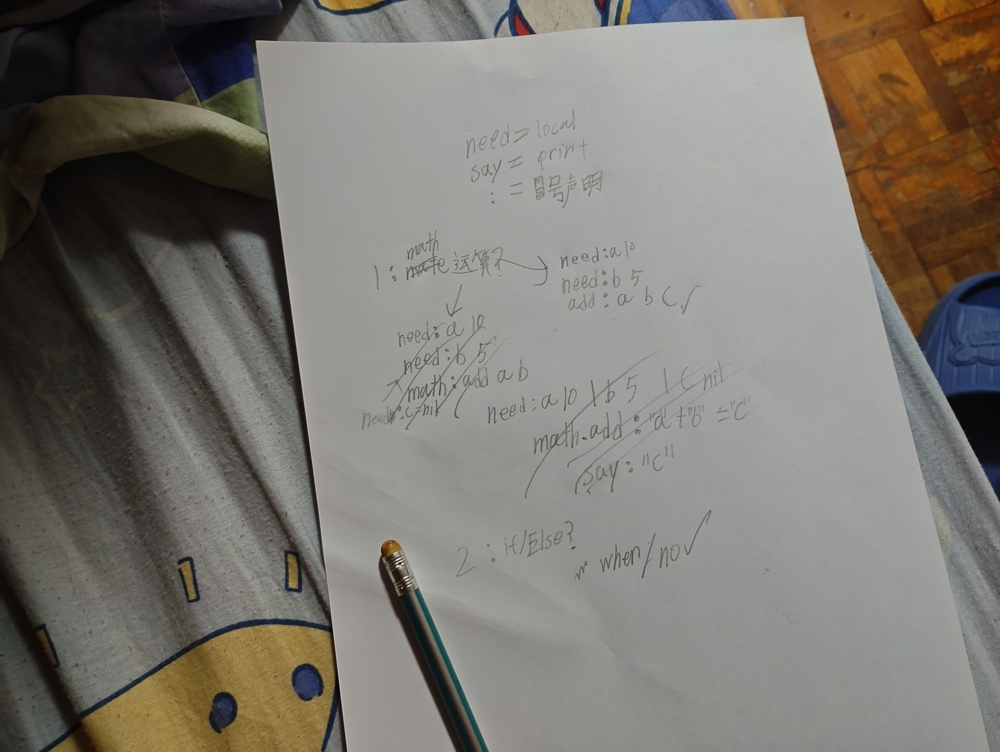

# MemeGlue

> **To hell with semicolons and commas. Programming should read like a sentence.**

`Python 3.x` · `0 dependencies` · `186 lines` · `.meme`

MemeGlue is a glue language. It sits in the seam between Python's ergonomics and C/C++ raw power, and it refuses to carry any syntax noise across that seam.

---

## Philosophy

**1. Zero Syntax Noise**
No semicolons. No commas. Ever. Arguments are separated by plain spaces, statements end at the newline.

**2. Raw Text by Default**
Everything after `: ` is raw text, straight to the end of the line. The only time you touch a quote is when you need a variable interpolated.

**3. The Ultimate Glue**
MemeGlue is middleware. Its job is to stitch Python-level logic onto C++-level FFI without either side noticing the seam.

**4. Minimalist Control Flow**
`when:` instead of `if`. `no:` instead of `else`. No `end`, no braces, no `fi`. Four spaces own the block.

---

## Syntax at a glance

| Intent | MemeGlue | Python |
|---|---|---|
| Declare | `need: name World` | `name = "World"` |
| Output | `say: Hello "name"` | `print(f"Hello {name}")` |
| Branch | `when: "age" >= 18` | `if age >= 18:` |
| Else | `no:` | `else:` |
| Loop N | `loop: 3` | `for _ in range(3):` |
| Loop while | `loop: "count" > 0` | `while count > 0:` |
| Loop forever | `loop: always` | `while True:` |
| Break | `stop` | `break` |

---

## Examples

### Hello World and variables

```meme
need: name World
say: Hello "name" this is MemeGlue first run.
```

### Math

Operands first, destination last.

```meme
add: 5 3 total
say: 5 plus 3 equals "total"
```

`add:` `sub:` `mul:` `div:` all follow the same shape. A quoted operand is a variable, a bare number is a literal.

### Branching

```meme
need: age 17
when: "age" >= 18
    say: You are an adult.
no:
    say: You are a minor.
```

### Loops (Turing complete)

```meme
need: count 3
loop: "count" > 0
    say: Countdown "count"
    sub: "count" 1 count
loop: always
    say: Running indefinitely
    when: "count" == 0
        stop
```

Three loop modes behind one keyword, selected by what follows the colon: a bare integer counts, an expression is tested before every pass, and `always` never asks.

---

## How to run

```bash
python meme_interpreter.py hello.meme
```

That is the whole setup. No virtualenv, no 200MB dependency tree, no build step. Python 3.x and the file itself.

---

## Hard rules

| Rule | Consequence |
|---|---|
| `;` or `,` anywhere in a `.meme` file | Hard error: the parser refuses to run |
| Statements separated by newline only | One statement per line |
| Arguments split by spaces only | No positional ambiguity, no quoting ceremony |
| Blocks defined by 4-space indent | No `end` keyword to forget |
| Variables read via `"name"` | Text stays raw until you ask for a value |

---

## Roadmap

- **Current** — Python MVP interpreter. Variables, math, branching, three loop modes, `stop`, text interpolation.
- **Next** — Native FFI integration: `glue: load "kernel32.dll"`. Declare a C ABI symbol, call it from `.meme`, keep the type boundary honest.
- **Future** — AI-driven ecosystem porting. A language small enough for a model to hold entirely in context.

---

### 📜 Origin Blueprint

*The handwritten draft of MemeGlue, conceptualized on a messy bed.*
*(创世手稿：在一个凌乱的床上推演出的极简语言)*



---

## Author

**Toxic Fox (17 y/o)** — Written from a single bed, fighting against a broken system with pure logic.
